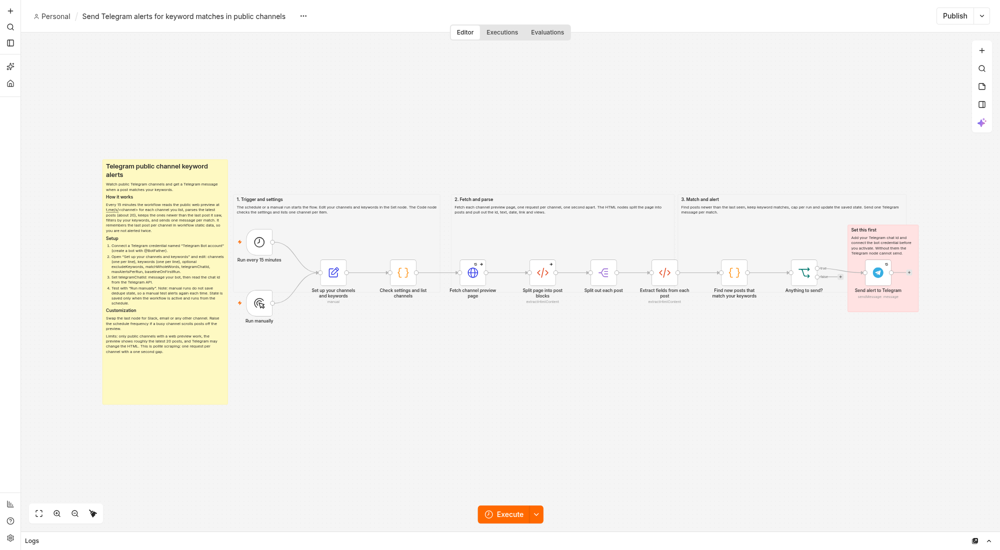
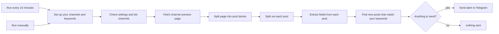

# Telegram channel keyword alerts

An n8n workflow template that watches public Telegram channels and pings you on
Telegram the moment a post matches your keywords.

## Overview



## The problem it solves

Following several Telegram channels for one or two topics means either muting
everything and missing things, or leaving notifications on and scrolling past
dozens of irrelevant posts a day. This workflow reads the channels for you and
only speaks up when something you actually care about appears.

## What it does

Every 15 minutes (or on a manual run) the workflow:

1. Reads your list of channels and keywords from a single settings node.
2. Fetches each channel's public web preview page, one request at a time.
3. Parses the page into individual posts (id, text, date, link, views).
4. Keeps the posts newer than the last one it saw per channel.
5. Filters those by your keywords, respecting an optional exclude list.
6. Sends one Telegram message per match, capped per run with a short summary
   when there are more matches than the cap.

It reads only the public preview at `https://t.me/s/<channel>`, so no Telegram
API id or user session is needed. The only credential is a bot token, used to
send the alert.

## Architecture



State lives entirely in workflow static data (the highest post id seen per
channel), read and written inside "Find new posts that match your keywords",
and it only persists for executions started by the schedule trigger on an
active workflow.

## How to run it

### Requirements

- Tested on n8n 2.44.7, self-hosted or cloud.
- A Telegram bot: create one with @BotFather and copy its token.
- Your chat id: message your bot, then open
  `https://api.telegram.org/bot<token>/getUpdates` and read `chat.id`. For a
  group, add the bot to the group first.

### Import and credentials

1. Import `workflow.json`.
2. Open **Send alert to Telegram** and connect a Telegram credential named
   `Telegram Bot account` using your bot token. No other node needs a
   credential.
3. Save and activate the workflow.

### Settings

Everything else is edited in one place, the **Set up your channels and
keywords** node:

- `channels`: one per line. Accepts `name`, `@name`, `t.me/name`,
  `https://t.me/name` and `https://t.me/s/name`.
- `keywords`: one per line. Phrases are allowed.
- `excludeKeywords`: optional. Any match here vetoes the post.
- `matchWholeWords`: on by default, so `ai` does not match `mail`.
- `telegramChatId`: replace the placeholder `YOUR_TELEGRAM_CHAT_ID`.
- `maxAlertsPerRun`: default 10.
- `baselineOnFirstRun`: on by default, so the first run per channel records
  the latest post and sends nothing.
- `previewBaseUrl`: default `https://t.me/s/`. Only worth changing if you are
  pointing the workflow at a mirror or a test server.

## Design decisions

- **Error handling is per channel.** The HTML parsing nodes continue on
  error, so a channel that errors or returns an empty page is treated as "no
  posts" rather than failing the run, and the other channels still get
  processed and alerted.
- **Retries, and what `maxTries` really means.** n8n counts `maxTries` as the
  total number of attempts, not the number of retries. The HTTP node has
  `maxTries: 2`, so it retries once on failure. The Telegram node has
  `maxTries: 3` with a 2 second wait between tries, so it retries twice
  before giving up.
- **Dedupe via a `lastSeen` id, not a log of seen posts.** Only the highest
  post id seen per channel is stored, under `lastSeen_<channel>` in workflow
  static data. Posts at or below that id never alert again, and the id
  advances every run even when nothing matched.
- **Caps and the "+N more" summary.** `maxAlertsPerRun` bounds how many
  individual messages one run can send for one channel. When there are more
  matches than the cap, the newest ones (in chronological order) are sent
  individually and the rest are rolled into one summary message, such as
  `+3 more matching posts not shown`.
- **Gap detection.** The public preview only shows a page's worth of recent
  posts. If the lowest new post id is more than one past the stored
  `lastSeen`, older posts may have scrolled off before this run saw them. The
  note about this rides on an actual alert message, so a gap in a run with no
  matching post stays silent rather than sending a message on its own.
- **HTML escaping and length limits.** Every dynamic field in the Telegram
  message (channel name, matched keywords, link) is HTML-escaped before it is
  placed in the HTML-parse-mode message, and each is clipped to a fixed
  length. The snippet is shrunk in a loop until the whole message fits
  Telegram's 4096-character limit, and the structure (header, date, matched
  list, link) is the last thing to be cut.
- **Whole-word matching is Unicode-aware, not just ASCII.** With
  `matchWholeWords` on, a keyword is bounded by anything that is not a
  Unicode letter, digit or underscore, so `ai` matches `AI` or `(AI)` but not
  `mail`, and the same logic matches `żółć` regardless of case. Keywords are
  escaped before being turned into regular expressions, so characters such as
  `c++`, `.net` or `$BTC` are matched literally.
- **One-off notices, not repeated noise.** A channel that returns no posts
  sends exactly one "returned no posts" notice, then stays quiet until it
  recovers, at which point it goes quiet again without a message. A baseline
  run (the first run for a channel with `baselineOnFirstRun` on) records
  state but never reaches the Telegram node, so it sends nothing at all.

## Tests and how to run them

- `npm test` runs the full unit and structure suite offline, in well under a
  second: 86 tests covering settings validation, HTML parsing and entity
  decoding, keyword matching (case, Unicode, whole-word, regex-escaping),
  dedupe state, gap detection, caps and summaries, message formatting and
  length limits, workflow structure (no orphan nodes, every node reachable,
  sticky note layout), and a golden fixture run end to end through the
  shipped Code nodes. 85 run and pass offline; the remaining one (the
  node-version check below) is skipped unless `N8N_NODES_BASE` is set.
- `npm run lint:copy` checks README.md, LISTING.md and the sticky note text in
  `workflow.json` for em dashes and American spellings.
- `npm run build` regenerates `workflow.json` from the Code node sources in
  `src/`; a test fails if the committed file is stale.
- The node-version check (every node type and typeVersion exists in the
  installed n8n) needs a local n8n install; set `N8N_NODES_BASE` to its
  `n8n-nodes-base/dist/nodes` directory to run it, otherwise it is reported
  as skipped.
- An optional live end-to-end check exists in `scripts/e2e.mjs`, run against a
  local n8n instance with `N8N_URL` and `N8N_API_KEY` set. It imports the
  workflow unchanged through the n8n API, points it at two local mock
  servers (a fake preview page and a fake Telegram Bot API), and asserts on
  the real executions: baseline, new matches, no repeats, the alert cap with
  its summary, the gap note, and a dead or dropped channel not stopping the
  others. The real Telegram Bot API is never called. A full run is recorded
  in `samples/e2e-run.txt`.

## Sample output

A real alert produced by the fixture in `fixtures/`, exactly as the Telegram
node would receive it in HTML parse mode (from `samples/alert-message.txt`):

```
<b>@examplechannel</b>
2026-07-22 14:00 UTC

Voice messages on Telegram now show a waveform preview before you hit send.

Matched: Telegram
<a href="https://t.me/examplechannel/537">Open post</a>
```

## Known limits

- The preview shows roughly the latest 20 posts per channel. A very busy
  channel can scroll posts off between runs; the gap note exists for this,
  but raising the schedule frequency is the real fix.
- Only public channels with a web preview work. Private channels and groups
  do not.
- Telegram can change the preview HTML, which may need the selectors
  updated.
- This is polite scraping: one request per channel per run, with a one
  second gap and the default 15 minute schedule.
- A forwarded post is parsed like any other post: the forwarded content
  becomes the alert text and snippet, and the "Forwarded from" label itself
  is never matched against your keywords.
