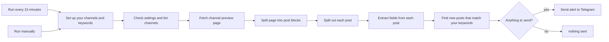

# Telegram channel keyword alerts

An n8n workflow that watches public Telegram channels and sends me a Telegram message when a post matches my keywords. It is a demo: it runs locally against fixture pages, and the tests never touch Telegram.


## What it does

Every 15 minutes, or when you run it by hand, it:

1. Reads your channels and keywords from one settings node.
2. Fetches each channel's public preview page, one request at a time.
3. Splits the page into posts and pulls out the id, text, date, link and view count.
4. Drops any post that is not newer than the last one it saw for that channel.
5. Checks the rest against your keywords, with an optional exclude list.
6. Sends one Telegram message per match. If a channel has more matches than the cap, the rest become a single "+N more" line.

It only reads `https://t.me/s/<channel>`, so there is no Telegram API id and no user session. The one credential is the token @BotFather gives you, used to send the alerts.



The only state is the highest post id seen per channel, kept in workflow static data. n8n saves that only for an active workflow started by the schedule trigger. A manual run reads it but does not save it, so testing by hand alerts again each time.

## Running it

You need n8n (I tested on 2.44.7), a Telegram account created through @BotFather so you have a token, and your chat id. To find the chat id, message your account, open `https://api.telegram.org/bot<token>/getUpdates` and read `chat.id`. For a group, add the account to the group first.

Import `workflow.json`, open "Send alert to Telegram" and attach a Telegram credential called `Telegram account` that holds your token. Nothing else needs a credential. Save, then activate.

The rest is set in the "Set up your channels and keywords" node:

- `channels`: one per line. `name`, `@name`, `t.me/name`, `https://t.me/name` and `https://t.me/s/name` all work.
- `keywords`: one per line, phrases allowed.
- `excludeKeywords`: optional. A match here drops the post.
- `matchWholeWords`: on by default, so `tea` does not match `steam`.
- `telegramChatId`: replace `YOUR_TELEGRAM_CHAT_ID`. The workflow stops with an error while it is still there.
- `maxAlertsPerRun`: 10 by default.
- `baselineOnFirstRun`: on by default. The first run for a channel records its latest post and sends nothing.
- `previewBaseUrl`: `https://t.me/s/` by default. Only change it to point at a mirror or a test server.

## How a few things behave

Errors are handled per channel. The HTML nodes continue on error, so a channel that fails or comes back empty counts as having no posts, and the others are still processed. The HTTP node has `maxTries: 2` and the Telegram node `maxTries: 3` with a two second wait. n8n counts `maxTries` as total attempts, so that is one retry and two retries.

Only the highest post id per channel is stored, under `lastSeen_<channel>`. Posts at or below it never alert again, and the id moves forward on every run, even when nothing matched.

When a channel has more matches than `maxAlertsPerRun`, the newest ones are sent one by one, in order, and a single message such as `+3 more matching posts not shown` covers the rest.

The preview only shows about the latest 20 posts. If the lowest new post id is more than one above the stored one, some posts may have scrolled off unseen. A note about that is added to a real alert. If nothing matched in that run, nothing is sent.

Everything dynamic in a message (channel name, matched keywords, link) is HTML-escaped and clipped. The snippet is shortened until the whole message fits under Telegram's 4096 characters, and the header, date, keyword line and link are cut last.

Whole-word matching understands Unicode: a keyword must be bounded by something that is not a letter, digit or underscore, so `tea` matches `Tea` or `(TEA)` but not `steam`, and `żółć` matches whatever the case. Keywords are escaped before they become regular expressions, so `c++`, `.net` and `$BTC` are taken literally.

A channel that returns no posts gets one "returned no posts" message, then silence until it has posts again. A baseline run records state and never reaches the Telegram node.

## Tests

`npm test` runs offline in about a second. It covers settings validation, HTML parsing, keyword matching, dedupe state, gap detection, caps, message formatting and length, the workflow structure, and a golden run through the shipped Code nodes. One test checks that every node type and version exists in an installed n8n. It is skipped unless `N8N_NODES_BASE` points at that install's `n8n-nodes-base/dist/nodes` directory.

Other scripts:

- `npm run build` regenerates `workflow.json` from the Code node sources in `src/`. A test fails if the committed file is out of date.
- `npm run lint:copy` checks this file and the sticky notes for em dashes and American spellings.
- `npm run fixtures` rebuilds `fixtures/examplechannel.items.json` and `fixtures/none.items.json` from the HTML fixtures with the same Cheerio the HTML nodes use. It needs `N8N_NODES_BASE` too.
- `npm run samples` rebuilds the golden file in `tests/golden/` and the files in `samples/`. Run `fixtures` and then `samples` after editing `fixtures/examplechannel.html`.
- `npm run e2e` is an optional end-to-end run against a local n8n, with `N8N_URL` and `N8N_API_KEY` set. It imports the workflow unchanged, points it at two local mock servers (a fake preview page and a fake Telegram API) and checks the real executions: baseline, new matches, no repeats, the cap and its summary, the gap note, and a dead channel not stopping the others. The real Telegram API is never called.

## Sample output

This is an alert built from the fixture, as the Telegram node would receive it in HTML parse mode (`samples/alert-message.txt`):

```
<b>@examplechannel</b>
2026-07-22 14:00 UTC

Voice messages on Telegram now show a waveform preview before you hit send.

Matched: Telegram
<a href="https://t.me/examplechannel/537">Open post</a>
```

## Limits

- About 20 posts per channel are visible. A very busy channel can scroll past between runs. The gap note is there for that, but a shorter schedule is the real fix.
- Only public channels with a web preview work. Private channels and groups do not.
- Telegram can change the preview HTML, and the selectors would then need updating.
- It makes one request per channel per run with a one second gap, on a 15 minute schedule.
- A forwarded post is parsed like any other. The forwarded text becomes the alert text, and the "Forwarded from" label is never matched against your keywords.
